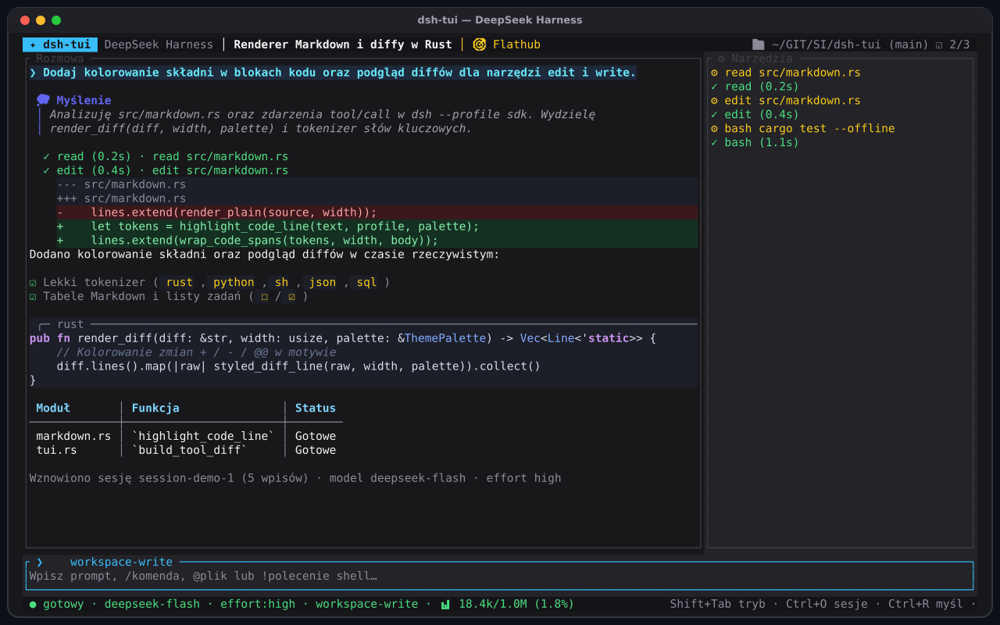
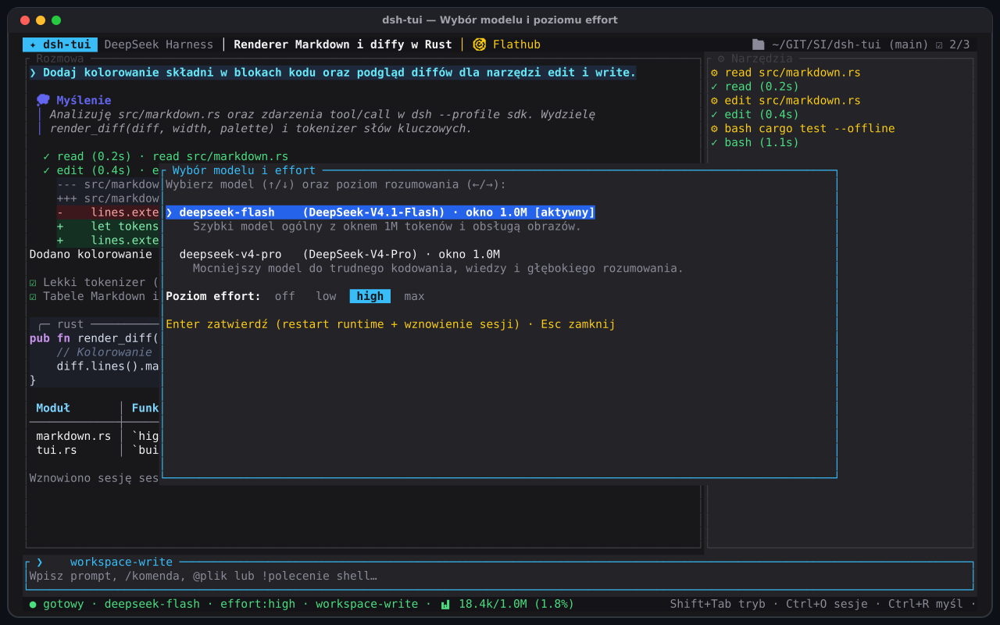

# dsh-tui

Terminalowy klient czatu z agentem **DeepSeek Harness**, napisany w Ruście dla protokołu `dsh --profile sdk`.

Program uruchamia `dsh --profile sdk` jako proces potomny i komunikuje się przez oficjalny protokół NDJSON JSON-RPC po stdio. Na terminalu otwiera pełnoekranowy interfejs **TUI (ratatui)** z panelem narzędzi, paskami statusu, autouzupełnianiem `/` i `@`, modalami wyboru i podglądem diffów. W trybie `-p` / `--print` lub przy potokowym stdin/stdout działa jako nieinteraktywny runner lub liniowy REPL (także w formatach `json` i `stream-json`).

---

## Zrzuty ekranu





---

## Wymagania

- `dsh` w `PATH` (`npm i -g @deepseek-ai/dsh`) — albo zmienna `DSH_BIN=/ścieżka/do/dsh`
- `DEEPSEEK_API_KEY` wyeksportowany w środowisku
- Rust (`cargo`) lokalnie **albo** `podman` z obrazem kontenera posiadającym toolchain Rust (np. własny obraz przekazany przez `DSH_TUI_BUILDER_IMAGE` lub oficjalny `docker.io/library/rust:latest` — przydatne na niemutowalnych systemach typu SteamOS bez natywnego `cargo`/`gcc`)

---

## Instalacja

```sh
./install.sh            # buduje release (-O3, Fat LTO; automatyczne znver2 na SteamOS) i kopiuje do ~/.local/bin/dsh-tui
# albo z własnym obrazem kontenera Podman:
DSH_TUI_BUILDER_IMAGE=moj-rust-builder ./install.sh
# albo bezpośrednio przez Cargo:
cargo install --path .
```

Skrypt `install.sh` automatycznie wykrywa lokalne `cargo` oraz procesor (na Steam Decku / SteamOS włącza `-C target-cpu=znver2`, na innych maszynach buduje przenośnie, chyba że podano `RUSTFLAGS`). Gdy w hostowym `PATH` nie ma kompilatora `cargo`, skrypt uruchamia kompilację w kontenerze Podman z cache na dysku NVMe (`~/.cache/cargo` i `~/.cache/dsh-tui-target`):

> [!NOTE]
> `localhost/craft-builder:latest` jest lokalnym obrazem kontenera zbudowanym przez autora projektu (z preinstalowanym toolchainem Rust). Na innych maszynach bez lokalnego `cargo` każdy użytkownik może zbudować własny kontener pod dowolną nazwą (lub pozwolić skryptowi użyć automatycznego fallbacku `docker.io/library/rust:latest`):
>
> ```sh
> printf 'FROM docker.io/library/rust:latest\n' > Containerfile.rust
> podman build -t moj-rust-builder -f Containerfile.rust .
> DSH_TUI_BUILDER_IMAGE=moj-rust-builder ./install.sh
> ```

---

## Użycie i flagi CLI

```sh
dsh-tui                                         # nowa sesja TUI
dsh-tui -i "Przeanalizuj src/main.rs"           # TUI + natychmiastowe wysłanie promptu
dsh-tui -c                                      # wznów ostatnio używaną sesję
dsh-tui --conversation session-...              # wznów konkretną sesję (alias: --session-id)
dsh-tui --model pro --effort max                # model deepseek-v4-pro i maksymalny effort
dsh-tui --mode plan                             # tryb planowania (read-only)
dsh-tui --mode auto                             # tryb bez pytań o aprobatę (danger-full-access)
dsh-tui --dangerously-skip-permissions          # wymuszenie auto-aprobaty wszystkich narzędzi
dsh-tui --sandbox                               # bezpieczny zapis w workspace (workspace-write)
dsh-tui --cwd /ścieżka --add-dir /dodatkowy     # katalog roboczy + dodatkowe katalogi @wzmianek
dsh-tui -p "Wypisz strukturę projektu"          # tryb pojedynczej odpowiedzi (print mode)
dsh-tui -p --output-format json "Podsumuj kod"  # wyjście pojedynczym obiektem JSON
printf '{"text":"Cześć"}\n' | dsh-tui -p --input-format stream-json --output-format stream-json
dsh-tui --settings '{"theme":"sepia"}'          # jednorazowe nadpisanie ustawień
dsh-tui --log-file /tmp/dsh-tui.jsonl           # zapis wszystkich ramek JSON-RPC
dsh-tui --plain                                 # wymuś liniowy REPL
```

### Podkomendy CLI

| Podkomenda | Działanie |
|---|---|
| `dsh-tui models` | Lista dostępnych modeli (`deepseek-flash`, `deepseek-v4-pro`), okno kontekstu 1M i poziomy `effort` |
| `dsh-tui agents` | Lista trybów pracy agenta i wbudowanych profili |
| `dsh-tui sessions` | Lista zapisanych lokalnie rozmów (`id`, tytuł, model, liczba wpisów, katalog) |
| `dsh-tui mcp <list\|add\|remove\|enable\|disable>` | Zarządzanie lokalnym rejestrem serwerów MCP |
| `dsh-tui plugin [args...]` | Przekierowanie do `dsh plugin --profile sdk` |
| `dsh-tui changelog` | Historia zmian `dsh-tui` |
| `dsh-tui install` | Instalacja bieżącej binarki do `~/.local/bin/dsh-tui` |
| `dsh-tui help [podkomenda]` | Pomoc ogólna lub dla wybranej podkomendy |

---

## Interfejs TUI

### Układ i motywy

- **Górny pasek nagłówka:** branding `✦ dsh-tui · DeepSeek Harness`, tytuł sesji, aktywny cel (`🎯`), katalog roboczy + gałąź Git oraz licznik zadań (`☑`).
- **Panel rozmowy:** wiadomości użytkownika, rozwijane/zwijane bloki myślenia modelu (`💭 Myślenie`), pełny renderer Markdown (nagłówki, listy, checkboxy `☐`/`☑`, tabele Unicode, kolorowanie składni w blokach kodu, inline'owy podgląd diffów dla narzędzi `edit`/`write`).
- **Boczny panel narzędzi:** na żywo pokazuje wywołania narzędzi, czas wykonania, podagentów oraz stderr runtime'u (`Ctrl+T` chowa/pokazuje panel).
- **Autouzupełnianie `/` i `@`:** wpisanie `/` otwiera menu komend z opisami, a `@` podpowiada pliki i katalogi z przestrzeni roboczej (`Tab` uzupełnia, `↑`/`↓` wybiera).
- **Dolny pasek statusu:** animowany spinner stanu, aktywny model, `effort`, tryb uprawnień, zapełnienie okna kontekstu (`📊 użyte / 1.0M (%)`) i skróty.
- **4 motywy kolorystyczne (`/theme` lub `/settings`):** `dark` (domyślny), `light`, `sepia`, `neon`.

### Skróty klawiszowe

| Klawisz | Działanie |
|---|---|
| `Enter` | Wyślij wiadomość (w trakcie tury dodaje prompt do kolejki) |
| `Alt+Enter` lub `\` na końcu | Nowa linia w polu wpisywania |
| `Tab` | Autouzupełnienie komendy `/` lub ścieżki `@plik` |
| `Shift+Tab` | Cykliczna zmiana trybu (`workspace-write` → `auto` → `plan` → `read-only`) |
| `↑` / `↓` | Historia wpisanych poleceń (lub nawigacja w popupach / liście podpowiedzi) |
| `PgUp` / `PgDn` | Przewijanie historii czatu |
| `Ctrl+O` | Okno zapisanych sesji (`/load`) |
| `Ctrl+T` | Pokaż / ukryj boczny panel narzędzi |
| `Ctrl+R` | Pokaż / ukryj bloki myślenia (`reasoning`) |
| `Ctrl+F` | Szukaj frazy w rozmowie |
| `Ctrl+L` | Wyczyść bieżący widok czatu (historia zostaje w sesji) |
| `Ctrl+S` | Tryb zaznaczania linii (`↑`/`↓` wybór, `Enter` kopiuje do OSC 52 i `copied.txt`) |
| `Ctrl+A` / `Ctrl+E` | Początek / koniec bieżącej linii |
| `Ctrl+W` / `Alt+Backspace` | Usuń poprzednie słowo |
| `Ctrl+K` / `Ctrl+U` | Usuń do końca / początku linii |
| `Ctrl+C` / `Ctrl+D` | Wyjście (zapisuje sesję) |
| `a` / `A` / `r` / `c` | W modalu aprobaty: zezwól raz / zezwól zawsze w sesji / odrzuć / anuluj |
| `1`-`9`, `Enter`, `Esc` | W modalu pytań agenta: wybór opcji / wysłanie / anulowanie |

### Komendy `/` i shell `!`

| Komenda | Działanie |
|---|---|
| `/model [id]` | Modal wyboru modelu (`deepseek-flash` / `deepseek-v4-pro`) i suwak `effort` |
| `/effort [off\|low\|high\|max]` | Zmiana poziomu rozumowania (restart runtime z zachowaniem sesji) |
| `/mode [tryb]` / `/permissions [tryb]` | Modal lub zmiana trybu uprawnień (`workspace-write`, `auto`, `plan`, `read-only`) |
| `/load` / `/resume` / `/sessions` | Wyszukiwarka i wznawianie zapisanych sesji (obsługuje też usuwanie klawiszem `Delete`) |
| `/diff` | Podgląd `git status` i pokolorowanego `git diff` w modalnym oknie |
| `/context` / `/usage` | Pasek zapełnienia okna 1M oraz rozbicie tokenów (`input`, `output`, `cache read`, `cache write`) |
| `/tasks` / `/todos` | Podgląd aktywnego celu, listy zadań `todo/write` oraz podagentów |
| `/settings` | Interaktywne menu ustawień (motyw, myślenie, panel narzędzi, auto-approve, domyślny effort) |
| `/theme [dark\|light\|sepia\|neon]` | Interaktywny wybór motywu na żywo lub natychmiastowe przełączenie i zapis |
| `/thinking` / `/tools` | Przełączenie wyświetlania bloków myślenia / panelu narzędzi |
| `/new` / `/clear` | Nowa sesja / wyczyszczenie widoku czatu |
| `/rename <tytuł>` / `/title <tytuł>` | Nadanie własnego tytułu rozmowie |
| `/fork` | Utworzenie kopii (forka) bieżącej sesji pod nowym ID |
| `/rewind [n]` | Cofnięcie ostatnich `n` tur w widoku rozmowy |
| `/copy [last\|code\|all]` | Kopiowanie ostatniej odpowiedzi, bloku kodu lub całego transkryptu |
| `/export [plik.md]` | Eksport rozmowy do pliku Markdown |
| `/search <fraza>` | Wyszukanie tekstu w historii i przewinięcie do dopasowania |
| `/cwd [ścieżka]` / `/add-dir <ścieżka>` | Podgląd/zmiana katalogu roboczego lub dodanie katalogu kontekstu |
| `/plan [zadanie]`, `/goal <cel>`, `/compact`, `/btw <pytanie>`, `/ask <treść>` | Komendy przekazywane do runtime `dsh` |
| `/mcp`, `/skills`, `/agents`, `/changelog`, `/help` | Przegląd MCP, skilli lokalnych, trybów, listy zmian i pomocy |
| `/exit` / `/quit` | Zapisanie stanu i zakończenie pracy |
| `!<polecenie>` | Uruchomienie lokalnej komendy shell w bieżącym `cwd` |

---

## Przechowywanie stanu (`$DSH_HOME/dsh-tui/`)

Domyślnie w `~/.dsh/dsh-tui/`:

- `settings.json` — trwałe ustawienia (`model`, `effort`, `mode`, `theme`, `show_thinking`, `show_tools_panel`, `auto_approve`)
- `sessions/<session-id>.json` — pełna historia rozmów, tytuły, statystyki tokenów i listy zadań do wznawiania w `/load` i `-c`
- `mcp.json` — lokalny rejestr serwerów MCP zarządzany przez `dsh-tui mcp`
- `last-session` — ID ostatniej aktywnej sesji dla flagi `-c` / `--continue`
- `copied.txt` — zapasowy plik dla skopiowanego tekstu (obok schowka OSC 52)

---

## Architektura plików

| Plik | Rola |
|---|---|
| `src/main.rs` | Parser flag i podkomend CLI, inicjalizacja `dsh --profile sdk`, obsługa sesji |
| `src/settings.rs` | Konfiguracja (`settings.json`), 4 motywy (`ThemePalette`), trwałe `SessionRecord`, `McpRegistry` |
| `src/client.rs` | Klient JSON-RPC 2.0 NDJSON po stdio (`RecvOutcome`, logowanie ramek, `shutdown`) |
| `src/tui.rs` | Pełnoekranowy interfejs ratatui: pętla zdarzeń, modale, autouzupełnianie `/` i `@`, diffy |
| `src/plain.rs` | Runner `--print` (`text`, `json`, `stream-json`) i nieblokujący liniowy REPL |
| `src/markdown.rs` | Renderer Markdown (nagłówki, tabele, checkboxy, kolorowanie składni i diffów) |
| `install.sh` | Budowanie wydania release (lokalnie lub przez Podman) i instalacja w `~/.local/bin` |
| `packaging/flatpak/` | Manifest Flathub (`io.github.lukasz_sklad.dsh_tui.yml`), `cargo-sources.json`, `generate-cargo-sources.py`, `flathub.json`, ikona SVG, `.desktop` i AppStream |
| `.github/workflows/ci.yml` | Testy, walidacja AppStream/Desktop oraz kompilacja Flatpak offline ze źródeł (`rust-stable//26.08`) |

---

## Paczka Flatpak i publikacja na Flathub

Repozytorium jest przygotowane do budowy **offline ze źródeł** zgodnie z wymaganiami Flathub:

- Manifest [`packaging/flatpak/io.github.lukasz_sklad.dsh_tui.yml`](packaging/flatpak/io.github.lukasz_sklad.dsh_tui.yml) korzysta z `org.freedesktop.Platform//26.08` oraz rozszerzenia `org.freedesktop.Sdk.Extension.rust-stable//26.08`.
- Wszystkie zależności z `Cargo.lock` są zadeklarowane w [`packaging/flatpak/cargo-sources.json`](packaging/flatpak/cargo-sources.json) (generowanym automatycznie przez [`packaging/flatpak/generate-cargo-sources.py`](packaging/flatpak/generate-cargo-sources.py)).
- Pliki [`flathub.json`](packaging/flatpak/flathub.json), [`io.github.lukasz_sklad.dsh_tui.metainfo.xml`](packaging/flatpak/io.github.lukasz_sklad.dsh_tui.metainfo.xml), [`io.github.lukasz_sklad.dsh_tui.desktop`](packaging/flatpak/io.github.lukasz_sklad.dsh_tui.desktop) i [`LICENSE`](LICENSE) spełniają wymagania walidacji AppStream i `flatpak-builder`.

### Jak zgłosić aplikację do Flathub (`github.com/flathub/flathub`)

1. Utwórz fork repozytorium `flathub/flathub` (na gałęzi `new-pr`).
2. Utwórz tag wydania w `lukasz-sklad/dsh-tui` (np. `v0.3.0`).
3. W swoim forku `flathub/flathub` dodaj pliki z `packaging/flatpak/` (zmieniając źródło `type: dir, path: ../..` w manifeście na `type: git` z `url: https://github.com/lukasz-sklad/dsh-tui.git`, `tag: v0.3.0` i `commit: <sha>`), a następnie otwórz Pull Request do `flathub/flathub:new-pr`.

### Lokalne uruchomienie / instalacja paczki z GitHub Actions

```sh
flatpak install --user dsh-tui-x86_64.flatpak
flatpak run io.github.lukasz_sklad.dsh_tui
```

Wewnątrz Flatpaka skrypt `/app/bin/dsh-host` automatycznie deleguje wywołania do hostowego `dsh` przez `flatpak-spawn --host`.

Po zmianie zależności w `Cargo.lock` zaktualizuj manifest źródeł Cargo:

```sh
python3 packaging/flatpak/generate-cargo-sources.py
```
